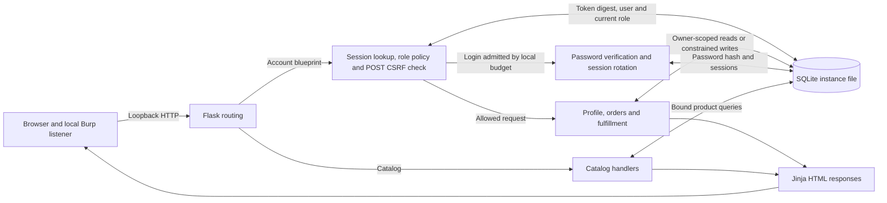

# Request and data flow

The browser-to-Flask boundary carries untrusted selectors, form fields and bearer cookies. The service-to-database boundary binds values and applies ownership predicates. SQLite trusts the application process to enforce user-level authorization. The HTML response crosses a third boundary when the browser interprets text and quoted attributes. Login pages also use Jinja. Redirects, error responses and framework static-file serving take shorter paths.

The local seed CLI creates users, salted hashes and order snapshots outside the HTTP surface. A person with filesystem access to the database is outside the web-role model. Burp is an observation point on the same machine as the browser and server.
